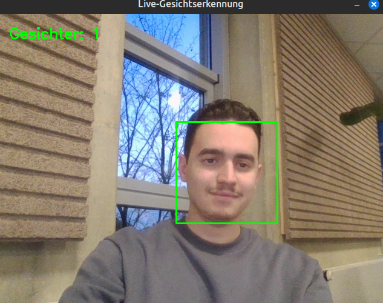
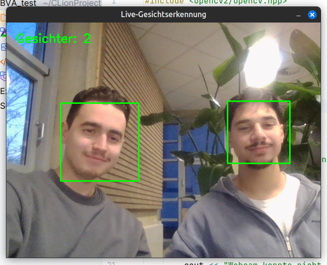

# Live-Gesichtserkennung mit OpenCV

Ein persönliches Lernprojekt in C++, das Gesichter im Livebild einer Webcam erkennt und markiert.

## Demo

### Ein erkanntes Gesicht

### Zwei erkannte Gesichter

## Motivation

Im Praktikum zum Modul Bildverarbeitung (BVA) haben wir uns mit Gesichtstracking beschäftigt. Das hat mich neugierig gemacht, wie ich Gesichter in einem Webcam-Bild selbst lokalisieren kann. Deshalb habe ich das Programm aus eigenem Interesse umgesetzt und dabei punktuell KI als Unterstützung genutzt.

## Funktionsweise

1. Das Programm liest ein Bild von der Webcam ein, wandelt es in Graustufen um und halbiert Breite und Höhe für die Erkennung.
2. Ein Histogrammausgleich passt den Kontrast an. Anschließend sucht ein Haar-Kaskaden-Klassifikator nach frontalen Gesichtern.
3. Das Programm rechnet die gefundenen Positionen auf die ursprüngliche Bildgröße zurück, zeichnet grüne Rahmen und zeigt die Anzahl erkannter Gesichter an.

Die Erkennung läuft für jedes Bild separat. Mit **Esc** lässt sich das Programm beenden.

## Voraussetzungen

- Webcam
- C++-Compiler mit C++20-Unterstützung
- CMake 4.2 oder neuer, wie in der `CMakeLists.txt` angegeben
- OpenCV mit Entwicklungsdateien, das CMake über `find_package(OpenCV REQUIRED)` findet
